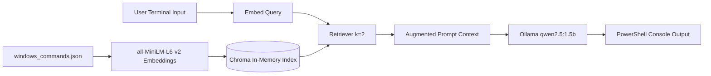

# Chapter 1: Basic RAG Fundamentals (Baseline)

## 1. Learning Objectives
* Understand how external unstructured/structured text is injected into an LLM prompt.
* Learn what dense vector embeddings are and how similarity search works.
* Observe the end-to-end RAG lifecycle: Data -> Embeddings -> Vector Index -> Retrieval -> Prompt -> Local LLM.

---

## 2. Concepts to Understand
* **Tokens & Vectors:** An embedding model converts human text into fixed-size numeric vectors (e.g., 384 numbers). Texts with similar meanings end up close together in geometric space.
* **Vector Distance:** Cosine similarity or Euclidean distance measures closeness between a user question vector and document vectors.
* **Retrieval-Augmented Generation (RAG):** Rather than fine-tuning a model, we retrieve relevant text and paste it into the prompt (`Context: ...`), instructing the LLM to base its answer on that context.
* **In-Memory vs. Persistent:** This baseline creates an **in-memory** Chroma database on every launch. When the script exits, the vectors are lost.

---

## 3. Architecture Overview



---

## 4. Exact Files in Chapter 1
* `rag_cli.py`: Complete working CLI program.
* `windows_commands.json`: Knowledge base containing Windows and custom commands.

---

## 5. Step-by-Step Implementation Review
1. **Load data:** Read `windows_commands.json` into Python dictionaries.
2. **Convert to Documents:** Wrap each item into a LangChain `Document(page_content=..., metadata=...)`.
3. **Instantiate Embedding Model:** `HuggingFaceEmbeddings(model_name="sentence-transformers/all-MiniLM-L6-v2")`.
4. **Create In-Memory Vector Store:** `Chroma.from_documents(docs, embeddings)`.
5. **Set up Retriever:** `vector_store.as_retriever(search_kwargs={"k": 2})`.
6. **Query & Generate:** In `ask_rag(query)`, retrieve top matches, build the prompt, and call `ollama.chat(model="qwen2.5:1.5b", ...)`.

---

## 6. PowerShell Commands to Run

From repository root:
```powershell
.\.venv\Scripts\activate
python .\rag_cli.py
```
*(Or choose Option 1 in `python .\.learning_data\main.py`)*

---

## 7. Required Packages & Services
* **Ollama Service:** Must be running locally in Windows (`ollama run qwen2.5:1.5b`).
* **Python Virtual Environment:** Contains `langchain-chroma`, `sentence-transformers`, `ollama`.

---

## 8. Expected Output
```text
Ask command (e.g. 'how to see hidden files like ls -a') [or 'exit']: what is the command zainbhai used for?

The command zainbhai is a dummy test command created by the USER 'Zain Irfan' to see the RAG answer correctly. It is just a placeholder command and is not a real command.
```

---

## 9. Manual Experiments to Try
* Ask: `how to see hidden files` -> Check that it returns both CMD (`dir /a`) and PowerShell (`Get-ChildItem -Force`).
* Ask: `who is the president of Mars?` -> Notice how the small model attempts to answer or hallucinates because the retriever still returns the closest 2 documents.

---

## 10. Troubleshooting Guidance
* **Ollama Connection Error:** Ensure Ollama is running. Open a separate terminal and run `ollama list`.
* **Deprecation Warning:** `langchain_community` emits a sunset warning. This will be addressed in Chapter 2 without breaking compatibility.

---

## 11. Completion Checklist
- [x] Baseline script runs without fatal errors.
- [x] Embeddings are computed locally on CPU.
- [x] Ollama `qwen2.5:1.5b` returns synthesized answers.
- [x] Git commit `e533c85` captures this working baseline.

---

## 12. Bridge to Chapter 2
Notice that every time you run `python .\rag_cli.py`, you see:
```text
Loading weights: 100%|...
```
The CPU re-encodes the entire document set every time the script starts! In Chapter 2, you will learn how to persist the vector store to disk so startup is near-instant.
