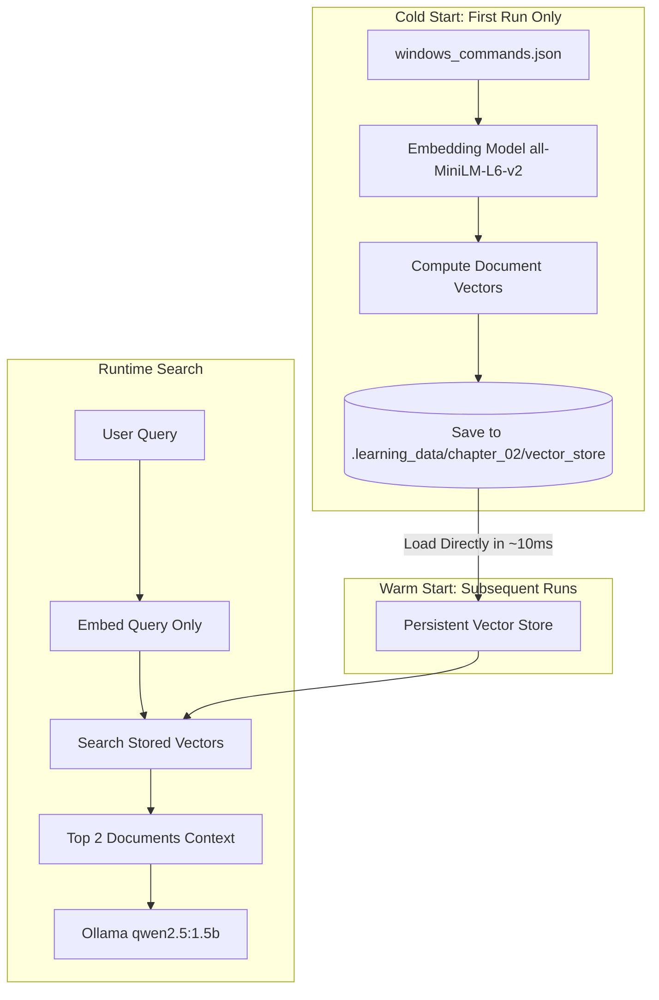

# Chapter 2: Persistence and Embedding Reuse

## 1. Learning Objectives
* Understand the lifecycle of models and vectors: downloading vs. memory loading vs. embedding generation.
* Distinguish between **document embeddings** (precomputed once) and **query embeddings** (calculated per user question).
* Persist vector stores to disk so the application starts instantly without re-embedding documents.
* Detect when the index exists on disk and load it directly.
* Measure cold-start latency vs. warm-start latency with Python timers.

---

## 2. Core Concepts to Master

### The 6 Distinct Stages
1. **Downloading Model Weights:**
   * Happens **once** from Hugging Face Hub.
   * Stored in your user cache (`~/.cache/huggingface/hub`).
   * Does not consume RAM until loaded.
2. **Loading Model into Memory (RAM):**
   * Happens when `HuggingFaceEmbeddings(...)` is instantiated.
   * Transfers weights from SSD into CPU RAM (~250 MB).
   * Takes roughly 0.5–1.2 seconds on your Core i5 CPU.
3. **Generating Document Embeddings:**
   * Passes your knowledge base text through the model to produce vectors.
   * **Cost:** High (proportional to total words in all documents).
   * In Chapter 1, this happened every time `rag_cli.py` was launched!
4. **Persisting Vector Index to Disk:**
   * Writing vectors, document text, and metadata into a local directory (`.learning_data/chapter_02/vector_store`).
   * Once saved, document vectors never need to be computed again unless the source documents change.
5. **Reloading an Existing Index:**
   * Opening the persistent directory from disk. Takes only a few milliseconds.
   * Zero embedding calculations needed for documents!
6. **Generating Query Embeddings:**
   * When the user asks a question, **that question must still be embedded** dynamically to search against the saved document vectors.
   * Only 1 query is embedded per question, taking ~15–30 ms.

---

## 3. Architecture Overview



---

## 4. Files You Will Create

You will create your Chapter 2 implementation inside this directory:
* File to create: `.learning_data/chapter_02/rag_persistent.py`
* Persistent storage path: `.learning_data/chapter_02/vector_store/` (automatically created by Chroma)

> **Important:** Keep `rag_cli.py` at the root unchanged. Chapter 2 is a separate implementation.

---

## 5. Step-by-Step Implementation Guide

### Step 5.1: Install the Updated Embeddings Package (Optional Cleanup)
To silence the `langchain-community` deprecation warning, you can install the standalone package:
```powershell
pip install langchain-huggingface
```
Then import:
```python
from langchain_huggingface import HuggingFaceEmbeddings
```
*(If you prefer to keep existing packages, `langchain_community.embeddings` still works).*

### Step 5.2: Write `rag_persistent.py`
Create the file `.learning_data/chapter_02/rag_persistent.py`. Your script should follow this logic:

```python
import os
import json
import time
import ollama
from pathlib import Path
from langchain_chroma import Chroma
from langchain_core.documents import Document

# Try modern import first, fallback to community
try:
    from langchain_huggingface import HuggingFaceEmbeddings
except ImportError:
    from langchain_community.embeddings import HuggingFaceEmbeddings

# Define paths relative to this script
SCRIPT_DIR = Path(__file__).resolve().parent
REPO_ROOT = SCRIPT_DIR.parent.parent
DB_DIR = SCRIPT_DIR / "vector_store"
DOCS_FILE = REPO_ROOT / "windows_commands.json"

print(f"[INIT] Vector Store Directory: {DB_DIR}")

# 1. Initialize local embedding model
t0 = time.perf_counter()
print("[INFO] Loading embedding model into RAM...")
embeddings = HuggingFaceEmbeddings(model_name="sentence-transformers/all-MiniLM-L6-v2")
print(f"[DONE] Model loaded in {time.perf_counter() - t0:.2f}s")

# 2. Check if persistent vector store already exists
if not DB_DIR.exists() or not any(DB_DIR.iterdir()):
    print("\n[COLD START] No persistent index found. Embedding documents from scratch...")
    t_index = time.perf_counter()
    
    with open(DOCS_FILE, "r", encoding="utf-8") as f:
        commands_data = json.load(f)

    docs = [
        Document(
            page_content=f"Task: {item['task']}\nBash: {item['bash']}\nCMD: {item['cmd']}\nPowerShell: {item['powershell']}\nNotes: {item['notes']}",
            metadata={"task": item["task"]}
        )
        for item in commands_data
    ]

    vector_store = Chroma.from_documents(
        documents=docs,
        embedding=embeddings,
        persist_directory=str(DB_DIR)
    )
    print(f"[COLD START] Indexed {len(docs)} documents in {time.perf_counter() - t_index:.2f}s")
else:
    print("\n[WARM START] Persistent index found on disk! Reusing existing embeddings...")
    t_load = time.perf_counter()
    vector_store = Chroma(
        persist_directory=str(DB_DIR),
        embedding_function=embeddings
    )
    print(f"[WARM START] Vector store loaded in {time.perf_counter() - t_load:.4f}s (No re-embedding!)")

retriever = vector_store.as_retriever(search_kwargs={"k": 2})

def ask_rag(query: str):
    t_query = time.perf_counter()
    results = retriever.invoke(query)
    context = "\n---\n".join([doc.page_content for doc in results])
    
    prompt = f"""You are a Windows CLI assistant. Based ONLY on the following context, answer the user's question with the exact Windows CMD and PowerShell commands.

Context:
{context}

Question: {query}
Answer:"""

    response = ollama.chat(
        model="qwen2.5:1.5b",
        messages=[{"role": "user", "content": prompt}]
    )
    duration = time.perf_counter() - t_query
    return response["message"]["content"], duration

if __name__ == "__main__":
    print("\nReady! Ask questions or type 'exit'.")
    while True:
        query = input("\nAsk command: ")
        if query.strip().lower() == "exit":
            break
        answer, dur = ask_rag(query)
        print(f"\n{answer}\n(Answered in {dur:.2f}s)")
```

---

## 6. PowerShell Commands to Test

From the repository root:

1. **First Execution (Cold Start):**
   ```powershell
   python .\.learning_data\chapter_02\rag_persistent.py
   ```
   * Observe output: notice `[COLD START]` appears and `vector_store/` is created on disk.
   * Type `exit`.

2. **Second Execution (Warm Start):**
   ```powershell
   python .\.learning_data\chapter_02\rag_persistent.py
   ```
   * Observe output: notice `[WARM START]` appears! Notice the loading time drops to almost `0.005s`!

---

## 7. Manual Experiments to Try
1. Inspect `.learning_data/chapter_02/vector_store/` with PowerShell:
   ```powershell
   Get-ChildItem .\.learning_data\chapter_02\vector_store
   ```
   Look at `chroma.sqlite3`. Chroma stores index metadata and vectors directly in this local SQLite file!
2. Delete the directory:
   ```powershell
   Remove-Item -Recurse -Force .\.learning_data\chapter_02\vector_store
   ```
   Run the script again: observe how it gracefully falls back to `[COLD START]`.

---

## 8. Verification Checklist
- [ ] Created `rag_persistent.py` inside `.learning_data/chapter_02/`.
- [ ] On first run, documents are embedded and saved to `vector_store/`.
- [ ] On subsequent runs, `[WARM START]` reuses saved vectors without re-embedding.
- [ ] Questions about `zainbhai` and `hidden files` answer accurately.
- [ ] Repository root `rag_cli.py` remains untouched.

---

## 9. Git Instructions
Because `.learning_data/` is ignored by Git in `.gitignore`:
* Run `git status` to verify that your `vector_store/` and local test files are **not** polluting Git.
* If you update any documentation outside `.learning_data/`, commit it cleanly.

---

## 10. Bridge to Chapter 3
Now that we have persistent vectors, what happens when our documents are hundreds of pages long instead of 4 short items? In Chapter 3, you will learn **Chunking strategies**, **Overlap**, and **Similarity Score Thresholds**.
