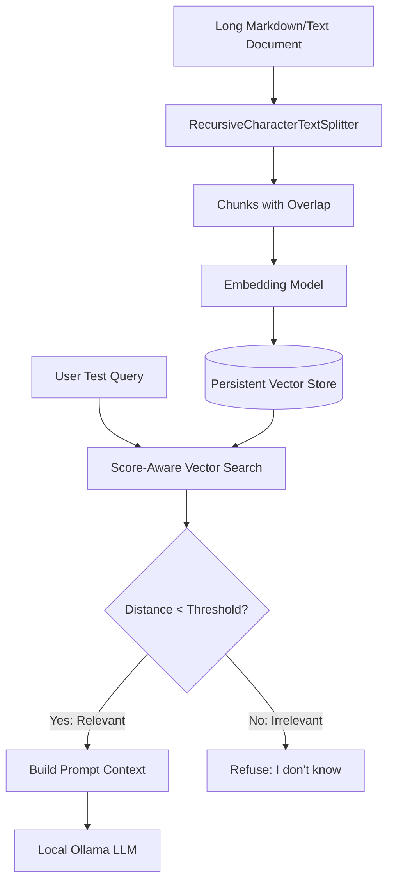

# Chapter 3: Chunking, Retrieval Quality, and RAG Evaluation

## 1. Learning Objectives
* Understand how long documents are broken down into chunks using size and overlap.
* Master similarity scores (cosine distance vs. similarity thresholds).
* Prevent hallucinations by enforcing a minimum relevance threshold.
* Build an automated, repeatable evaluation script to test RAG accuracy.

---

## 2. Core Concepts to Master

### Why Chunking Matters
LLMs have context window limits, and embeddings work best on focused passages. If an entire manual is embedded as one single vector, subtle details get blurred out.

* **Chunk Size:** The number of characters or tokens in each segment (e.g. 500 characters).
* **Chunk Overlap:** The number of characters shared between consecutive chunks (e.g. 50 characters). Overlap ensures that ideas crossing chunk boundaries aren't severed.

### Distance vs. Similarity Thresholds
In vector search, distance measures dissimilarity:
* **Distance = 0.0:** Exact match.
* **Distance > 1.0 (or high):** Unrelated text.

In Chapter 1, when you asked `what is the command zainbhai used for?` before adding it to the JSON, the retriever returned the hidden-files chunk anyway because `k=2` always returns the top 2 matches, regardless of relevance!
By checking `similarity_search_with_score()`, you can say:
> *"If the lowest distance is greater than 0.8, refuse to answer: no relevant documentation found."*

---

## 3. Architecture Overview



---

## 4. Files You Will Create
Inside `.learning_data/chapter_03/`:
* `sample_manual.txt`: A multi-paragraph document describing Windows network commands (`ipconfig`, `netstat`, `ping`).
* `evaluate_rag.py`: An automated script that tests 4 questions (3 valid, 1 out-of-scope) and checks whether the system answers correctly or refuses.

---

## 5. Step-by-Step Implementation Guide

### Step 5.1: Create `sample_manual.txt`
Create `.learning_data/chapter_03/sample_manual.txt` with several sections explaining network tools:
```text
# Windows Networking Guide

## ipconfig
The ipconfig command displays all current TCP/IP network configuration values.
Running 'ipconfig /all' displays detailed configuration including DHCP and DNS servers.
Running 'ipconfig /flushdns' purges the DNS Resolver cache.

## ping
The ping command verifies IP-level connectivity to another computer or domain.
Usage: 'ping google.com' or 'ping 192.168.1.1'.
In PowerShell, Test-Connection can also be used.

## netstat
The netstat command displays active TCP connections and listening ports.
Usage: 'netstat -ano' displays all connections with process IDs (PID).
```

### Step 5.2: Create `evaluate_rag.py`
Use `langchain_text_splitters.RecursiveCharacterTextSplitter` and `similarity_search_with_score`:

```python
import time
from pathlib import Path
from langchain_chroma import Chroma
from langchain_text_splitters import RecursiveCharacterTextSplitter
from langchain_core.documents import Document

try:
    from langchain_huggingface import HuggingFaceEmbeddings
except ImportError:
    from langchain_community.embeddings import HuggingFaceEmbeddings

SCRIPT_DIR = Path(__file__).resolve().parent
DB_DIR = SCRIPT_DIR / "eval_store"

# 1. Chunking with overlap
with open(SCRIPT_DIR / "sample_manual.txt", "r", encoding="utf-8") as f:
    raw_text = f.read()

splitter = RecursiveCharacterTextSplitter(
    chunk_size=200,
    chunk_overlap=40
)
docs = splitter.create_documents([raw_text])
print(f"[INFO] Split document into {len(docs)} chunks.")

# 2. Vector indexing
embeddings = HuggingFaceEmbeddings(model_name="sentence-transformers/all-MiniLM-L6-v2")
vector_store = Chroma.from_documents(docs, embeddings, persist_directory=str(DB_DIR))

# 3. Test questions with expected outcome
TEST_CASES = [
    {"query": "How do I flush the DNS cache?", "should_find": True},
    {"query": "Which command shows listening ports and PIDs?", "should_find": True},
    {"query": "How do I make chocolate cake?", "should_find": False},  # Irrelevant query!
]

SIMILARITY_THRESHOLD = 0.9  # Distance threshold: above this is deemed irrelevant

print("\nRunning Evaluation Suite:\n" + "=" * 50)
for tc in TEST_CASES:
    query = tc["query"]
    results_with_scores = vector_store.similarity_search_with_score(query, k=1)
    
    doc, score = results_with_scores[0]
    is_relevant = score <= SIMILARITY_THRESHOLD
    status = "PASS" if is_relevant == tc["should_find"] else "FAIL"
    
    print(f"Query: '{query}'")
    print(f"  Best Match Distance: {score:.4f}")
    print(f"  Accepted as relevant: {is_relevant} (Expected: {tc['should_find']}) -> [{status}]\n")
```

---

## 6. PowerShell Commands to Test

```powershell
python .\.learning_data\chapter_03\evaluate_rag.py
```

---

## 7. Expected Output
```text
Running Evaluation Suite:
==================================================
Query: 'How do I flush the DNS cache?'
  Best Match Distance: 0.3821
  Accepted as relevant: True (Expected: True) -> [PASS]

Query: 'Which command shows listening ports and PIDs?'
  Best Match Distance: 0.4109
  Accepted as relevant: True (Expected: True) -> [PASS]

Query: 'How do I make chocolate cake?'
  Best Match Distance: 1.2842
  Accepted as relevant: False (Expected: False) -> [PASS]
```

---

## 8. Verification Checklist
- [ ] Created `sample_manual.txt` and `evaluate_rag.py`.
- [ ] Observed chunk boundaries and overlap in action.
- [ ] Validated that distance scores differentiate relevant CLI queries from unrelated questions.
- [ ] Irrelevant queries successfully flagged as irrelevant without hallucination.

---

## 9. Bridge to Chapter 4
Now that you know how to chunk text and evaluate vector distance, how do you handle structured data like usernames, user permissions, and relational tables? That brings us to **Chapter 4: SQLite Fundamentals**.
