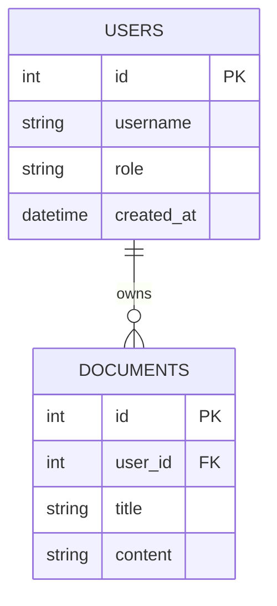

# Chapter 4: SQLite and Persistent Application Data

## 1. Learning Objectives
* Understand the difference between **structured relational data** (SQLite) and **unstructured semantic data** (Vector DB).
* Use Python's built-in `sqlite3` standard library (no servers or external installations required).
* Design database tables with primary keys, foreign keys, and SQL queries.
* Seed sample user records and understand how SQLite lays the foundation for multi-user security.

---

## 2. Core Concepts to Master

### Relational Data vs. Vector Embeddings
| Feature | Relational Database (SQLite) | Vector Database (Chroma) |
| :--- | :--- | :--- |
| **Data Type** | Numbers, strings, foreign keys, timestamps | High-dimensional numeric arrays (embeddings) |
| **Search Mechanism** | Exact match (`WHERE user_id = 1`), filters, joins | Semantic similarity (`cosine distance`) |
| **Best Used For** | User accounts, roles, access permissions, audit logs | Finding document paragraphs by meaning |
| **Security Role** | **Defines authorization** (who owns what) | **Performs search** |

### Why Python's `sqlite3`?
SQLite is embedded directly inside Python. It writes to a single local file (e.g., `app.db`). There are no background server services, passwords, or network ports.

---

## 3. Database Schema



---

## 4. Files You Will Create
Inside `.learning_data/chapter_04/`:
* `sqlite_app.py`: Script to initialize the database, create tables, insert test records, and query records.
* `app.db`: Generated local SQLite file (ignored by Git).

---

## 5. Step-by-Step Implementation Guide

### Step 5.1: Create `sqlite_app.py`
Create `.learning_data/chapter_04/sqlite_app.py`:

```python
import sqlite3
from pathlib import Path

DB_FILE = Path(__file__).resolve().parent / "app.db"

def init_db():
    conn = sqlite3.connect(DB_FILE)
    cursor = conn.cursor()

    # 1. Create Users Table
    cursor.execute("""
    CREATE TABLE IF NOT EXISTS users (
        id INTEGER PRIMARY KEY AUTOINCREMENT,
        username TEXT UNIQUE NOT NULL,
        full_name TEXT NOT NULL,
        role TEXT NOT NULL DEFAULT 'user'
    );
    """)

    # 2. Create Documents Table with Foreign Key
    cursor.execute("""
    CREATE TABLE IF NOT EXISTS documents (
        id INTEGER PRIMARY KEY AUTOINCREMENT,
        user_id INTEGER NOT NULL,
        title TEXT NOT NULL,
        content TEXT NOT NULL,
        FOREIGN KEY (user_id) REFERENCES users (id)
    );
    """)

    # 3. Seed Users if table is empty
    cursor.execute("SELECT COUNT(*) FROM users;")
    if cursor.fetchone()[0] == 0:
        cursor.executemany("""
        INSERT INTO users (username, full_name, role) VALUES (?, ?, ?);
        """, [
            ("alice", "Alice Wonderland", "engineer"),
            ("bob", "Bob Builder", "admin")
        ])
        print("[INFO] Seeded users table (Alice, Bob).")

    conn.commit()
    conn.close()

def list_users():
    conn = sqlite3.connect(DB_FILE)
    cursor = conn.cursor()
    cursor.execute("SELECT id, username, full_name, role FROM users;")
    rows = cursor.fetchall()
    conn.close()
    return rows

if __name__ == "__main__":
    init_db()
    users = list_users()
    print("\nRegistered Users in SQLite:")
    print("-" * 40)
    for u in users:
        print(f"ID: {u[0]} | Username: {u[1]:<10} | Name: {u[2]:<18} | Role: {u[3]}")
```

---

## 6. PowerShell Commands to Test

```powershell
python .\.learning_data\chapter_04\sqlite_app.py
```

---

## 7. Expected Output
```text
[INFO] Seeded users table (Alice, Bob).

Registered Users in SQLite:
----------------------------------------
ID: 1 | Username: alice      | Name: Alice Wonderland   | Role: engineer
ID: 2 | Username: bob        | Name: Bob Builder        | Role: admin
```

---

## 8. Verification Checklist
- [ ] Created `sqlite_app.py` using Python's standard `sqlite3` module.
- [ ] Successfully initialized `app.db`.
- [ ] Tables `users` and `documents` created with schema relationships.
- [ ] Verified that `app.db` is ignored by Git in `.gitignore`.

---

## 9. Bridge to Chapter 5
Now that you have users in SQLite and vectors in Chroma, you are ready for the core milestone: **Chapter 5: Two Users, Two Knowledge Bases, and Data Isolation**.
