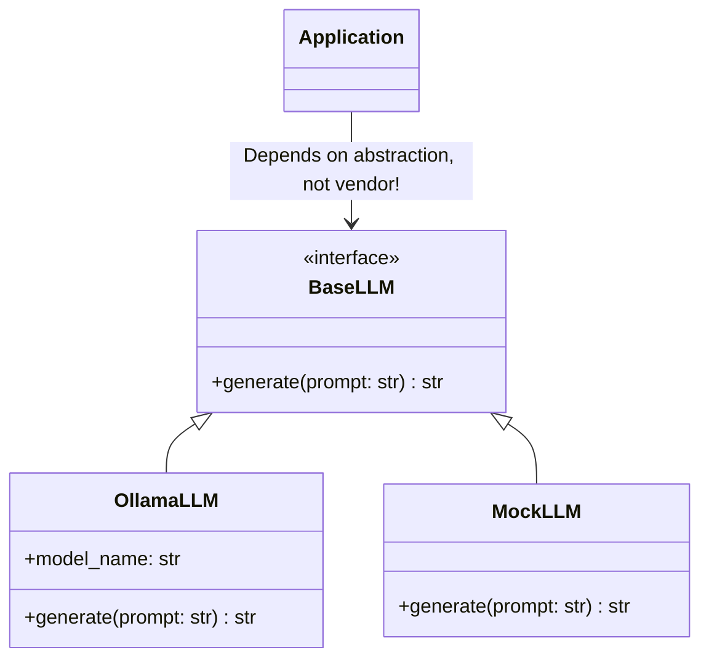

# Chapter 6: Local Language Models and Model Abstraction

## 1. Learning Objectives
* Understand the difference between **Embedding Models** (encoders) and **Generative LLMs** (autoregressive decoders).
* Master quantization (FP16 vs. Q8_0 vs. Q4_K_M) and its impact on CPU RAM and inference speed.
* Write a clean, provider-agnostic Python interface (`BaseLLM`) to decouple application code from specific LLM engines.
* Manage local inference resource budgets on your Core i5 CPU.

---

## 2. Core Concepts to Master

### Embedding Models vs. Generative Models
| Characteristic | Embedding Model (`all-MiniLM-L6-v2`) | Generative LLM (`qwen2.5:1.5b`) |
| :--- | :--- | :--- |
| **Architecture** | Encoder-only (BERT/Transformer) | Decoder-only (Autoregressive Transformer) |
| **Input** | String of text | Prompt (System + Context + User Question) |
| **Output** | Array of 384 floating-point numbers | Stream of generated text tokens |
| **Execution** | Deterministic, single matrix pass | Iterative loop (predicts next token one by one) |
| **CPU Time** | ~10–30 milliseconds | ~1–3 seconds |

### Understanding Quantization (Why 1.5B runs on your CPU)
Standard model weights are stored in 16-bit floating point numbers (FP16).
* A 7B parameter model in FP16 requires **14 GB of RAM** just to load! On your 16 GB machine without dedicated GPU, this would cause severe memory paging.
* In **Q4_K_M** (4-bit quantization), each weight takes only 4 bits. A 1.5B model takes under **1.0 GB RAM**, allowing fast inference (~30 tokens/sec on your Core i5-7200U).

---

## 3. Architecture: The Model Abstraction Layer



---

## 4. Files You Will Create
Inside `.learning_data/chapter_06/`:
* `model_wrapper.py`: Abstract base class and concrete Ollama implementation.

---

## 5. Step-by-Step Implementation Guide

Create `.learning_data/chapter_06/model_wrapper.py`:

```python
from abc import ABC, abstractmethod
import time
import ollama

class BaseLLM(ABC):
    """Abstract interface for local language models."""
    
    @abstractmethod
    def generate(self, prompt: str) -> str:
        pass

class OllamaLLM(BaseLLM):
    """Concrete wrapper for local Ollama service."""
    
    def __init__(self, model_name: str = "qwen2.5:1.5b"):
        self.model_name = model_name

    def generate(self, prompt: str) -> str:
        response = ollama.chat(
            model=self.model_name,
            messages=[{"role": "user", "content": prompt}]
        )
        return response["message"]["content"]

class MockLLM(BaseLLM):
    """Deterministic mock LLM for fast unit testing without CPU overhead."""
    
    def generate(self, prompt: str) -> str:
        return "[MOCK RESPONSE] Simulated model response for testing."

if __name__ == "__main__":
    print("\nTesting Model Abstraction Layer:\n" + "=" * 45)
    
    # 1. Test Mock LLM (instant, zero CPU load)
    mock = MockLLM()
    print(f"Mock Output:\n{mock.generate('Hello test')}\n")

    # 2. Test Real Ollama Model
    try:
        real_llm = OllamaLLM("qwen2.5:1.5b")
        t0 = time.perf_counter()
        resp = real_llm.generate("Explain in one short sentence what Windows PowerShell is.")
        t1 = time.perf_counter()
        print(f"Ollama Qwen 2.5 (1.5B) Response ({t1 - t0:.2f}s):\n{resp}\n")
    except Exception as e:
        print(f"[ERROR] Could not connect to Ollama: {e}")
```

---

## 6. PowerShell Commands to Test

```powershell
python .\.learning_data\chapter_06\model_wrapper.py
```

---

## 7. Verification Checklist
- [ ] Created `model_wrapper.py`.
- [ ] Verified that `BaseLLM` interface decouples code from vendor-specific libraries.
- [ ] Observed inference timing on your CPU.

---

## 8. Bridge to Chapter 7
When an LLM produces a wrong answer, how do you know which component failed? Was it bad retrieval, wrong permissions, or hallucination? Next: **Chapter 7: RAG Debugging and Observability**.
