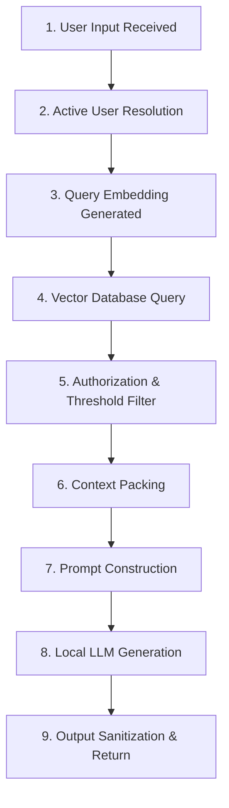

# Chapter 7: RAG Architecture and Debugging (Observability)

## 1. Learning Objectives
* Trace the complete **9-stage RAG lifecycle** step-by-step.
* Build lightweight structured logging without heavyweight third-party SaaS tools.
* Diagnose the exact root cause of failure: Retrieval miss vs. Permission denial vs. Context truncation vs. LLM hallucination.
* Maintain privacy by omitting raw user secrets from logs.

---

## 2. The 9-Stage RAG Execution Lifecycle



---

## 3. Diagnostic Matrix: Where Did It Fail?

| Symptom | Root Cause Stage | How to Diagnose |
| :--- | :--- | :--- |
| System claims "I don't know" for known command | **Stage 4 or 5** (Retrieval / Filter) | Check retrieved doc count and similarity distance score. |
| Model invents a non-existent command flag | **Stage 8** (Generation Hallucination) | Check Stage 7: Was the flag present in the prompt context? |
| Wrong user's data is revealed | **Stage 5** (Security Filter Bug) | Check metadata filter predicate in query. |
| Model output cuts off mid-sentence | **Stage 8** (Token Limit) | Check `num_predict` or context window limits. |

---

## 4. Files You Will Create
Inside `.learning_data/chapter_07/`:
* `traced_rag.py`: RAG script instrumented with structured stage tracing.

---

## 5. Production Implementation Overview

The complete production pipeline in `traced_rag.py` executes real vector embeddings, real Chroma DB queries, and local Ollama model generation with full telemetry:

1. **Stage 1 (Sanitization)**: Scans for secrets/API keys (`sk-...`, Bearer tokens, passwords) and scrubs them from the telemetry trace to maintain privacy.
2. **Stage 2 (RBAC / Tenant Resolution)**: Maps user ID to role (`guest` < `dev` < `admin`).
3. **Stage 3 (Embedding)**: Calls `all-MiniLM-L6-v2` and tracks exact embedding duration in milliseconds.
4. **Stage 4 (Vector Retrieval)**: Retrieves raw top-$k$ nearest neighbors and records raw Euclidean distance.
5. **Stage 5 (Authorization & Guardrail)**: Evaluates role level against document security clearance and enforces distance threshold (`< 1.25`).
6. **Stage 6 (Context Packing)**: Packs authorized chunks into context, checking character and token budgets.
7. **Stage 7 (Prompt Assembly)**: Assembles the prompt payload and logs payload size.
8. **Stage 8 (Generation)**: Calls `qwen2.5:1.5b` via local Ollama, recording generation latency and token throughput (tokens/sec).
9. **Stage 9 (Diagnostic Evaluation)**: Emits a structured `RAGTrace` and classifies execution into one of:
   * `SUCCESS`: Grounded answer generated.
   * `REFUSED_PERMISSION_DENIED`: Relevant knowledge exists in the vector store, but the active user role is not authorized.
   * `REFUSED_RETRIEVAL_MISS`: Vector distance exceeded threshold; knowledge base has no relevant data.
   * `MODEL_UNKNOWN_RESPONSE`: Context was provided, but model could not derive an answer.

---

## 6. PowerShell Commands to Test

```powershell
python .\.learning_data\chapter_07\traced_rag.py
```

---

## 7. Verification Checklist
- [ ] Created `traced_rag.py`.
- [ ] Verified that each of the 9 stages records its execution metrics.
- [ ] Validated that failure stages are immediately identifiable in the JSON trace.

---

## 8. Bridge to Chapter 8
RAG answers questions by reading text. But what if the user wants the system to **take action** (like querying a database or executing a calculation)? Next: **Chapter 8: Python Tools and LLM Tool Calling**.
