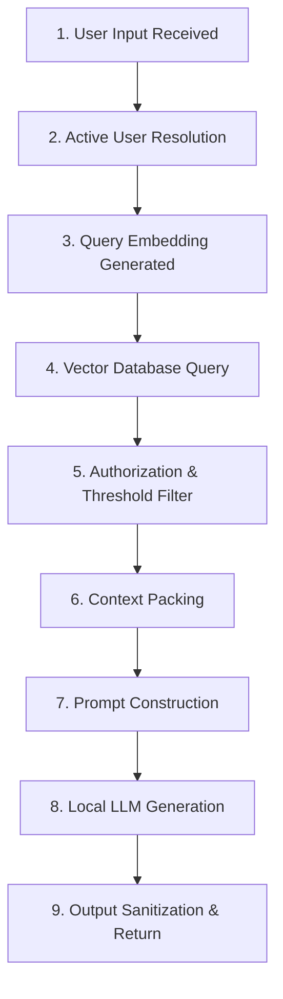

# Chapter 7: RAG Architecture and Debugging (Observability)

## 1. Learning Objectives
* Trace the complete **9-stage RAG lifecycle** step-by-step.
* Build lightweight structured logging without heavyweight third-party SaaS tools.
* Diagnose the exact root cause of failure: Retrieval miss vs. Permission denial vs. Context truncation vs. LLM hallucination.
* Maintain privacy by omitting raw user secrets from logs.

---

## 2. The 9-Stage RAG Execution Lifecycle



---

## 3. Diagnostic Matrix: Where Did It Fail?

| Symptom | Root Cause Stage | How to Diagnose |
| :--- | :--- | :--- |
| System claims "I don't know" for known command | **Stage 4 or 5** (Retrieval / Filter) | Check retrieved doc count and similarity distance score. |
| Model invents a non-existent command flag | **Stage 8** (Generation Hallucination) | Check Stage 7: Was the flag present in the prompt context? |
| Wrong user's data is revealed | **Stage 5** (Security Filter Bug) | Check metadata filter predicate in query. |
| Model output cuts off mid-sentence | **Stage 8** (Token Limit) | Check `num_predict` or context window limits. |

---

## 4. Files You Will Create
Inside `.learning_data/chapter_07/`:
* `traced_rag.py`: RAG script instrumented with structured stage tracing.

---

## 5. Step-by-Step Implementation Guide

Create `.learning_data/chapter_07/traced_rag.py`:

```python
import time
import json
from dataclasses import dataclass, asdict

@dataclass
class RAGTrace:
    stage_1_input: str = ""
    stage_2_user_id: int = 0
    stage_3_embed_duration_ms: float = 0.0
    stage_4_raw_retrieved_count: int = 0
    stage_5_auth_passed_count: int = 0
    stage_5_best_distance: float = 0.0
    stage_6_context_token_estimate: int = 0
    stage_7_prompt_length: int = 0
    stage_8_generation_duration_ms: float = 0.0
    stage_9_final_status: str = "PENDING"

def execute_with_trace(query: str, user_id: int):
    trace = RAGTrace(stage_1_input=query, stage_2_user_id=user_id)
    
    # Stage 3: Simulated Query Embedding
    t0 = time.perf_counter()
    time.sleep(0.015)  # simulate embedding computation
    trace.stage_3_embed_duration_ms = (time.perf_counter() - t0) * 1000

    # Stage 4 & 5: Simulated Retrieval & Auth Filtering
    # Example logic: User 1 owns docs, User 2 has none
    if user_id == 1 and "hidden" in query.lower():
        trace.stage_4_raw_retrieved_count = 1
        trace.stage_5_auth_passed_count = 1
        trace.stage_5_best_distance = 0.32
    else:
        trace.stage_4_raw_retrieved_count = 0
        trace.stage_5_auth_passed_count = 0
        trace.stage_5_best_distance = 1.45

    if trace.stage_5_auth_passed_count == 0:
        trace.stage_9_final_status = "REFUSED_NO_AUTHORIZED_CONTEXT"
        return "I do not have authorized information to answer this.", trace

    # Stage 6 & 7: Context & Prompt
    context = "dir /a displays hidden files."
    trace.stage_6_context_token_estimate = len(context.split())
    prompt = f"Context: {context}\nQuestion: {query}"
    trace.stage_7_prompt_length = len(prompt)

    # Stage 8: Generation
    t_gen = time.perf_counter()
    time.sleep(0.05)  # simulate model call
    trace.stage_8_generation_duration_ms = (time.perf_counter() - t_gen) * 1000
    trace.stage_9_final_status = "SUCCESS"

    return "Use 'dir /a' to see hidden files.", trace

if __name__ == "__main__":
    print("\nSimulating Traced Execution:\n" + "=" * 50)
    
    # Test 1: Successful Authorized Query
    ans1, trace1 = execute_with_trace("How to view hidden files?", user_id=1)
    print("Trace 1 (Success):")
    print(json.dumps(asdict(trace1), indent=2))
    
    # Test 2: Unauthorized / Missing Data Query
    ans2, trace2 = execute_with_trace("How to view hidden files?", user_id=2)
    print("\nTrace 2 (Refused):")
    print(json.dumps(asdict(trace2), indent=2))
```

---

## 6. PowerShell Commands to Test

```powershell
python .\.learning_data\chapter_07\traced_rag.py
```

---

## 7. Verification Checklist
- [ ] Created `traced_rag.py`.
- [ ] Verified that each of the 9 stages records its execution metrics.
- [ ] Validated that failure stages are immediately identifiable in the JSON trace.

---

## 8. Bridge to Chapter 8
RAG answers questions by reading text. But what if the user wants the system to **take action** (like querying a database or executing a calculation)? Next: **Chapter 8: Python Tools and LLM Tool Calling**.
