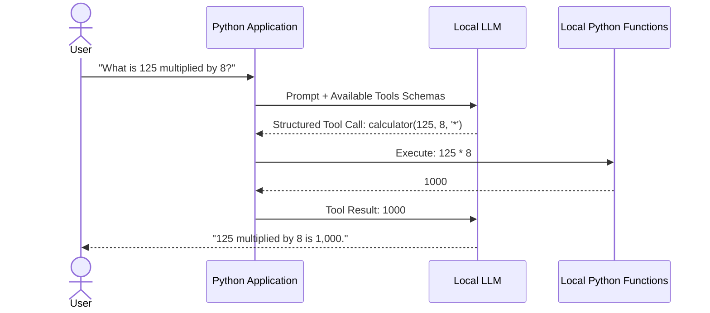

# Chapter 8: From RAG to Tool Calling

## 1. Learning Objectives
* Understand how LLMs transition from text generation to **structured tool invocation**.
* Distinguish between **ordinary Python functions**, **LLM tool calling**, and **autonomous agents**.
* Define tools using JSON schemas that local models can understand.
* Execute safe, deterministic local tools (user profile lookup, calculator, knowledge base search).

---

## 2. Core Concepts to Master

### Functions vs. Tool Calling vs. Agents
* **Ordinary Python Function:** Called directly by programmer code: `result = add(2, 2)`.
* **LLM Tool Calling:** The user asks a question in natural language (*"What is 45 * 89?"*). The LLM determines it cannot calculate math reliably in its weights, so it outputs a structured JSON instruction:
  ```json
  {"tool": "calculator", "arguments": {"a": 45, "b": 89, "op": "multiply"}}
  ```
  The Python program parses this JSON, runs the real Python function, and returns the exact numeric result to the LLM.
* **Agent:** An autonomous loop that can call multiple tools in sequence, observing each output to decide the next step.

---

## 3. Architecture Overview



---

## 4. Files You Will Create
Inside `.learning_data/chapter_08/`:
* `tool_agent.py`: Script defining local tools and executing them based on structured model output.

---

## 5. Step-by-Step Implementation Guide

Create `.learning_data/chapter_08/tool_agent.py`:

```python
import json

# 1. Deterministic local Python functions
def tool_calculator(a: float, b: float, operation: str) -> float:
    """Performs safe basic arithmetic."""
    if operation == "add": return a + b
    if operation == "subtract": return a - b
    if operation == "multiply": return a * b
    if operation == "divide": return a / b if b != 0 else float('nan')
    raise ValueError(f"Unknown operation: {operation}")

def tool_user_lookup(user_id: int) -> dict:
    """Returns safe mock user directory details."""
    users = {
        1: {"name": "Zain Irfan", "role": "Lead Architect", "status": "Active"},
        2: {"name": "Guest", "role": "Visitor", "status": "Restricted"},
    }
    return users.get(user_id, {"error": "User not found"})

# Registry mapping tool names to actual functions
TOOL_REGISTRY = {
    "calculator": tool_calculator,
    "user_lookup": tool_user_lookup
}

# 2. Tool Execution Engine
def execute_tool_call(tool_name: str, arguments: dict):
    if tool_name not in TOOL_REGISTRY:
        return {"error": f"Tool '{tool_name}' does not exist."}
    
    fn = TOOL_REGISTRY[tool_name]
    try:
        result = fn(**arguments)
        return {"status": "success", "result": result}
    except Exception as e:
        return {"status": "error", "message": str(e)}

if __name__ == "__main__":
    print("\nLocal Tool Execution Engine:\n" + "=" * 45)

    # Simulated model tool call 1: Math calculation
    call_1 = {"name": "calculator", "args": {"a": 45, "b": 12, "operation": "multiply"}}
    print(f"Executing: {call_1['name']} with {call_1['args']}")
    res_1 = execute_tool_call(call_1["name"], call_1["args"])
    print(f"Result: {res_1}\n")

    # Simulated model tool call 2: Database lookup
    call_2 = {"name": "user_lookup", "args": {"user_id": 1}}
    print(f"Executing: {call_2['name']} with {call_2['args']}")
    res_2 = execute_tool_call(call_2["name"], call_2["args"])
    print(f"Result: {res_2}\n")
```

---

## 6. PowerShell Commands to Test

```powershell
python .\.learning_data\chapter_08\tool_agent.py
```

---

## 7. Verification Checklist
- [ ] Created `tool_agent.py`.
- [ ] Verified that Python functions are safely invoked via structured parameter dictionaries.
- [ ] Observed error handling when invalid tool names or arguments are passed.

---

## 8. Bridge to Chapter 9
Executing one tool is useful. But how do you let an AI plan multiple steps, execute a tool, observe the result, and decide what to do next? Next: **Chapter 9: Agent Control Loops (ReAct)**.
