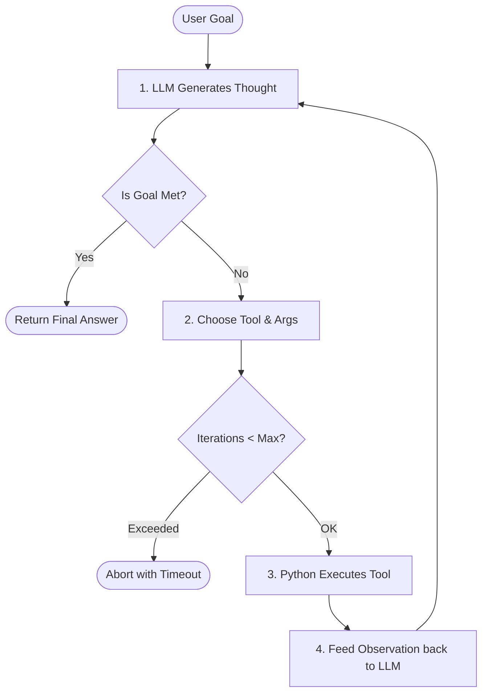

# Chapter 9: Agents and Agent Control Loops

## 1. Learning Objectives
* Understand what transforms an LLM from a passive text predictor into an **autonomous agent**.
* Build a deterministic **ReAct loop** (Reason -> Act -> Observe -> Repeat) from scratch in pure Python.
* Implement vital safety controls: **Maximum Iteration Caps**, **State Tracking**, and **Early Stopping**.
* Understand why simple RAG pipelines should *not* be turned into agents unless multi-step planning is strictly necessary.

---

## 2. Core Concepts to Master

### When Do You Actually Need an Agent?
* **Standard RAG (No Agent Needed):** "What is the command to view hidden files?" -> Single retrieval, single answer.
* **Agent Needed:** "Check if port 8080 is listening; if it is, find the process ID and terminate it; then report status." -> Requires multiple sequential tool calls where step 2 depends on step 1's outcome.

### The ReAct Cycle
1. **Thought:** The model reasons about the current state.
2. **Action:** The model chooses a tool and arguments.
3. **Observation:** The Python environment executes the tool and injects the output back into the conversation context.
4. **Repeat or Finish:** The model checks if the goal is satisfied.

---

## 3. Architecture Overview



---

## 4. Files You Will Create
Inside `.learning_data/chapter_09/`:
* `react_agent.py`: Pure Python control loop with iteration safety.

---

## 5. Step-by-Step Implementation Guide

Create `.learning_data/chapter_09/react_agent.py`:

```python
import time

def tool_get_system_time() -> str:
    return time.strftime("%Y-%m-%d %H:%M:%S")

def tool_check_file_exists(filename: str) -> str:
    import os
    return "EXISTS" if os.path.exists(filename) else "NOT_FOUND"

TOOLS = {
    "get_time": tool_get_system_time,
    "check_file": tool_check_file_exists,
}

def run_agent_loop(goal: str, max_steps: int = 3):
    print(f"\n[AGENT START] Goal: '{goal}' | Max Steps: {max_steps}")
    print("-" * 50)
    
    # State tracking
    step = 0
    history = []
    
    while step < max_steps:
        step += 1
        print(f"\n--- Step {step} ---")

        # In a full setup, the LLM produces the Thought and Action.
        # Here we simulate the deterministic reasoning steps for learning:
        if step == 1:
            thought = "I need to check the current system time to verify clock synchronization."
            action_tool = "get_time"
            action_args = {}
        elif step == 2:
            thought = "I need to check if 'windows_commands.json' is present in the workspace."
            action_tool = "check_file"
            action_args = {"filename": "windows_commands.json"}
        else:
            thought = "I have collected all necessary facts. I can answer now."
            action_tool = None
            action_args = {}

        print(f"Thought: {thought}")

        if action_tool is None:
            print("\n[AGENT FINISHED] Goal reached successfully.")
            return "Task completed with all verified observations."

        # Safety Check & Tool Execution
        print(f"Action: Calling {action_tool}({action_args})")
        fn = TOOLS[action_tool]
        observation = fn(**action_args)
        print(f"Observation: {observation}")
        
        history.append({"step": step, "thought": thought, "tool": action_tool, "obs": observation})

    print("\n[SAFETY LIMIT] Reached maximum allowed iterations. Stopping agent loop.")
    return "Agent aborted due to iteration limit."

if __name__ == "__main__":
    result = run_agent_loop("Audit workspace status and clock", max_steps=4)
    print(f"\nFinal Result: {result}")
```

---

## 6. PowerShell Commands to Test

```powershell
python .\.learning_data\chapter_09\react_agent.py
```

---

## 7. Verification Checklist
- [ ] Created `react_agent.py`.
- [ ] Observed the cyclic execution: Thought -> Action -> Observation.
- [ ] Confirmed that `max_steps` reliably prevents runaway infinite loops.

---

## 8. Bridge to Chapter 10
Now that you have seen agents in action, how do you make them reliable, testable, and hardened against crashes? Next: **Chapter 10: Harness Engineering**.
