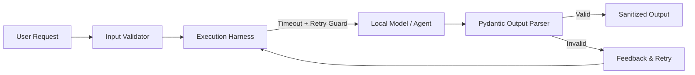

# Chapter 10: Harness Engineering and Reliability

## 1. Learning Objectives
* Understand what **Harness Engineering** means: the surrounding deterministic software architecture that wraps around an unpredictable AI model.
* Implement **Schema Validation** with Pydantic / dataclasses.
* Add **Retry Policies** with backoff for transient failures.
* Build a reproducible **Regression Test Suite** to ensure model output meets quality standards.

---

## 2. Core Concepts to Master

### Why Models Need a Software Harness
An LLM is a probabilistic text predictor. Left unconstrained, it can return invalid JSON, hallucinate parameters, loop infinitely, or crash.
The **Harness** is the rigorous Python framework that:
1. Validates inputs before the model sees them.
2. Enforces execution timeouts and memory caps.
3. Catches malformed outputs and retries with feedback.
4. Falls back to deterministic safe defaults on failure.

---

## 3. Architecture Overview



---

## 4. Files You Will Create
Inside `.learning_data/chapter_10/`:
* `test_harness.py`: Robust harness demonstrating schema validation, retries, and regression assertions.

---

## 5. Step-by-Step Implementation Guide

Create `.learning_data/chapter_10/test_harness.py`:

```python
import json
import time
from typing import Optional
from pydantic import BaseModel, Field, ValidationError

# 1. Strict Output Schema
class CommandRecommendation(BaseModel):
    task: str = Field(description="Summary of the user task")
    command_type: str = Field(pattern="^(cmd|powershell)$")
    command: str = Field(min_length=2)
    requires_admin: bool = False

# 2. Resilient Execution Harness with Retries
def simulate_flaky_model_call(attempt: int) -> str:
    # Simulates an LLM returning bad JSON on attempt 1, and valid schema on attempt 2
    if attempt == 1:
        return '{"task": "Show hidden files", "command_type": "bash"}'  # Fails regex!
    return '{"task": "Show hidden files", "command_type": "powershell", "command": "Get-ChildItem -Force", "requires_admin": false}'

def execute_with_harness(query: str, max_retries: int = 3) -> Optional[CommandRecommendation]:
    print(f"\n[HARNESS] Processing query: '{query}'")
    
    for attempt in range(1, max_retries + 1):
        print(f"  Attempt {attempt}/{max_retries}...")
        raw_output = simulate_flaky_model_call(attempt)
        
        try:
            data = json.loads(raw_output)
            validated = CommandRecommendation(**data)
            print("  [SUCCESS] Output passed all schema constraints!")
            return validated
        except (ValidationError, json.JSONDecodeError) as err:
            print(f"  [RETRY] Output validation failed: {err}")
            time.sleep(0.1)

    print("  [FATAL] Model failed to produce valid schema after retries.")
    return None

if __name__ == "__main__":
    print("\nTesting AI Engineering Harness:\n" + "=" * 45)
    result = execute_with_harness("How to view hidden files?")
    if result:
        print("\nValidated Object:")
        print(f"Task: {result.task}")
        print(f"Type: {result.command_type.upper()}")
        print(f"Command: {result.command}")
        print(f"Admin Required: {result.requires_admin}")
```

---

## 6. PowerShell Commands to Test

```powershell
python .\.learning_data\chapter_10\test_harness.py
```

---

## 7. Verification Checklist
- [ ] Created `test_harness.py`.
- [ ] Validated that invalid output triggers an automated retry cycle.
- [ ] Confirmed that only schema-compliant output is accepted.

---

## 8. Bridge to Chapter 11
Your backend is now robust, isolated, and tested. How do we expose this to a clean web browser interface without breaking security? Next: **Chapter 11: Connect a Small React Frontend**.
