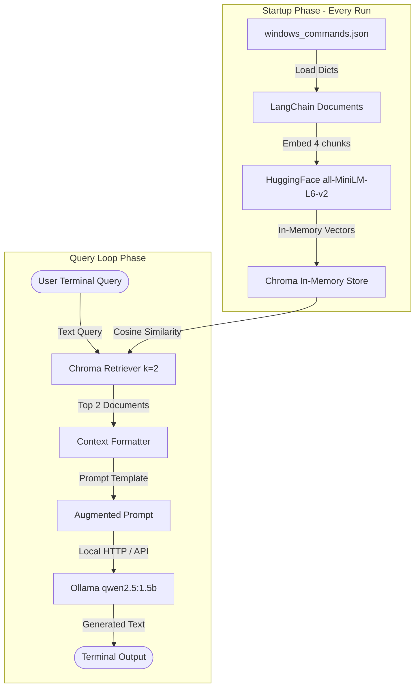

# Chapter 1: Basic RAG Architecture & Baseline Review

## 1. Objective
Establish a working baseline Retrieval-Augmented Generation (RAG) system running entirely on a local Windows machine without cloud dependencies.

---

## 2. Architecture Diagram

---

## 3. Component Breakdown

| Component | Responsibility | Current Implementation |
| :--- | :--- | :--- |
| **Document Store** | Stores source of truth commands | `windows_commands.json` (4 items) |
| **Embedding Model** | Converts text to 384-dimensional dense vectors | `sentence-transformers/all-MiniLM-L6-v2` |
| **Vector Index** | Computes vector distance and returns top matches | `langchain_chroma.Chroma` (in-memory only) |
| **Generative LLM** | Synthesizes an English answer using injected context | `ollama.chat` with `qwen2.5:1.5b` |
| **User Interface** | Interactive CLI loop | Python `input()` / `print()` in terminal |

---

## 4. Current Limitations & Findings (Bridge to Chapter 2)

1. **No Vector Persistence:**
   `Chroma.from_documents(...)` is invoked without a `persist_directory`. Every time `rag_cli.py` starts, all documents are re-embedded by the CPU from scratch.
2. **Deprecation Warnings:**
   `langchain_community.embeddings.HuggingFaceEmbeddings` is deprecated in favor of `langchain-huggingface`.
3. **Advisory Hugging Face Hub Warning:**
   An unauthenticated warning appears during weight download/check. It does not prevent local inference.
4. **Retrieval Guardrails:**
   Without a strict negative constraint or similarity distance threshold, the retriever will always return $k=2$ documents even for queries that have nothing to do with Windows commands (as seen with `zainbhai` before the document was added).

---

## 5. Verification Checklist

- [x] Python virtual environment `.venv` active.
- [x] Ollama service running locally with `qwen2.5:1.5b`.
- [x] Hugging Face model `all-MiniLM-L6-v2` cached locally.
- [x] Queries for existing commands (`dir /a`, `mkdir`) return accurate CLI syntax.
- [x] Queries for custom command (`zainbhai`) return the custom explanation synthesized by the model.
- [x] Git commit `e533c85` captures this working baseline.
